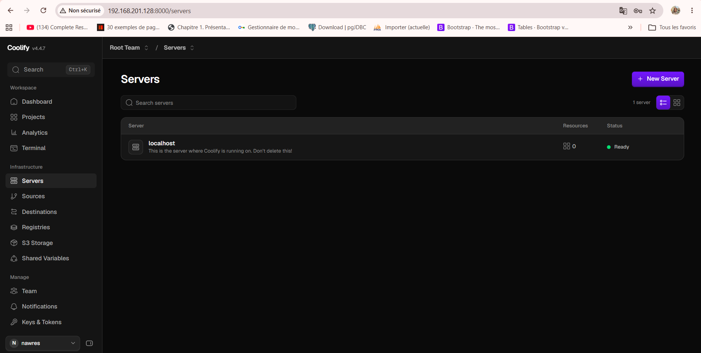
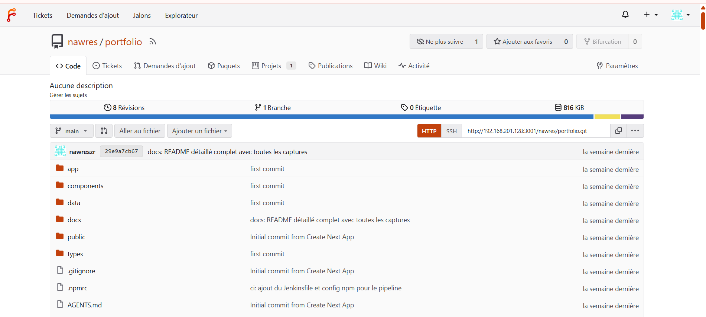
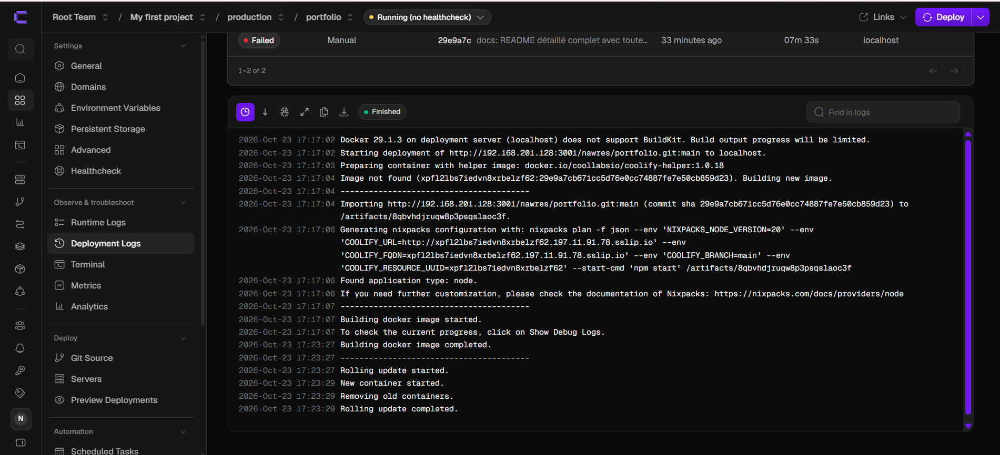
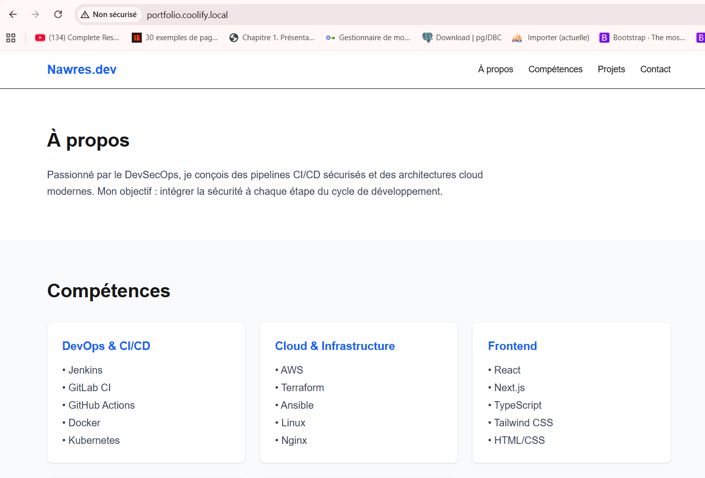
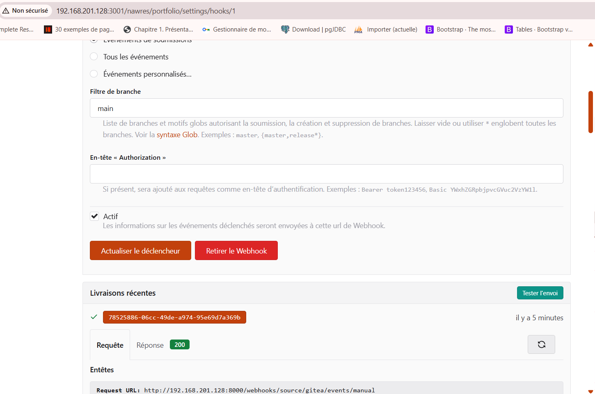
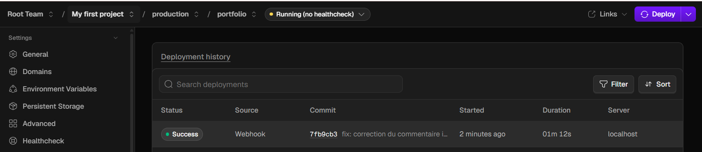

# TP2 – Déploiement d'un Portfolio Next.js avec Coolify et Forgejo

> **Enseignant :** Wahid Hamdi
> **Auteur :** Nawres Zarrouki

Déploiement d'un portfolio Next.js avec **Coolify** (PaaS auto-hébergé) depuis un dépôt **Forgejo** (forge Git auto-hébergée), entièrement en local dans une machine virtuelle : sans domaine DNS ni compte GitHub. Un `git push` redéploie automatiquement l'application grâce à un webhook.

## Sommaire

1. [Objectifs](#1-objectifs)
2. [Outils et architecture](#2-outils-et-architecture)
3. [Prérequis](#3-prérequis)
4. [Partie A : Installation de Coolify](#4-partie-a--installation-de-coolify)
5. [Partie B : Forgejo et dépôt du portfolio](#5-partie-b--forgejo-et-dépôt-du-portfolio)
6. [Partie C : Déploiement du portfolio](#6-partie-c--déploiement-du-portfolio)
7. [Partie D : Redéploiement automatique (webhook)](#7-partie-d--redéploiement-automatique-webhook)
8. [Rollback et supervision](#8-rollback-et-supervision)

---

## 1. Objectifs

- Installer Coolify et Forgejo dans une VM locale.
- Déployer une application Next.js depuis un dépôt Forgejo, accessible par un nom d'hôte local.
- Mettre en place un webhook Forgejo → Coolify : chaque `git push` redéploie l'application.
- Pratiquer le rollback et comparer l'approche PaaS (Coolify) avec l'approche IaC du TP1.

## 2. Outils et architecture

| Outil | Rôle dans le TP |
|---|---|
| Forgejo | Dépôt Git du portfolio ; émet le webhook à chaque push |
| Coolify | Clone, construit, déploie et expose l'application |
| Traefik (intégré à Coolify) | Routage HTTP par nom d'hôte |

```
Poste ──git push──► Forgejo (:3001) ──webhook──► Coolify (:8000)
                                                    │ clone + build (Nixpacks)
                                                    ▼
Navigateur ──http://portfolio.coolify.local──► Traefik (:80) ──► Next.js (:3000)
```

**Ports utilisés dans la VM :** 8000 (Coolify), 80 (Traefik), 3001 (Forgejo web), 2222 (Forgejo SSH). Le port 3000 reste interne à l'application Next.js.

## 3. Prérequis

| Élément | Détail |
|---|---|
| VM | Ubuntu 24.04, 2 vCPU, 4 Go de RAM recommandés, 20 Go de disque, accès `sudo` |
| Réseau | IP de la VM joignable depuis le poste, accès Internet sortant |
| VM dédiée | Coolify gère Docker et le proxy sur le port 80 : rien d'autre n'y est installé |
| Poste | Git installé, code du portfolio Next.js du TP1 |
| Domaine / GitHub | Aucun : nom d'hôte local via le fichier `hosts`, dépôt sur Forgejo |


---

## 4. Partie A : Installation de Coolify

```bash
ip -4 a                                  # noter l'IP de la VM
ssh nawres@192.168.201.128          # depuis le poste
curl -fsSL https://cdn.coollabs.io/coolify/install.sh | sudo bash
docker --version
docker ps
```

Puis ouvrir `http://192.168.201.128:8000`, créer immédiatement le compte administrateur et suivre l'assistant (serveur `localhost`).

Vérifications :

- Dashboard accessible et compte admin créé
- Serveur `localhost` en état *Reachable*
- Proxy démarré (*Servers → proxy*)



---

## 5. Partie B : Forgejo et dépôt du portfolio

### Installer Forgejo

```bash
docker compose up -d
docker ps          # le conteneur « forgejo » doit être Up
```

Fichier `forgejo/docker-compose.yml` :

```yaml
services:
  forgejo:
    image: codeberg.org/forgejo/forgejo:1.21
    container_name: forgejo
    environment:
      - USER_UID=1000
      - USER_GID=1000
      - FORGEJO__webhook__ALLOWED_HOST_LIST=external,private
    restart: always
    volumes:
      - ./data:/data
      - /etc/timezone:/etc/timezone:ro
      - /etc/localtime:/etc/localtime:ro
    ports:
      - "3001:3000"
      - "2222:22"
```

Points importants de ce fichier :

- port web **3001** (le 3000 est réservé à Next.js) ;
- `FORGEJO__webhook__ALLOWED_HOST_LIST=external,private` : par défaut, Forgejo refuse d'envoyer un webhook vers une adresse privée. Sans ce réglage, le webhook de la partie D échoue.

### Configuration initiale

Ouvrir `http://192.168.201.128:3001` et remplir l'assistant d'installation :

| Champ | Valeur |
|---|---|
| Base de données | SQLite3 |
| Domaine du serveur | `192.168.201.128` |
| URL de base de Forgejo | `http://192.168.201.128:3001/` |
| Compte administrateur | À créer (nom, mot de passe, e-mail fictif) |

### Créer le dépôt et y pousser le portfolio

Dans Forgejo : *Nouveau dépôt* → nom `portfolio`, visibilité **publique** (clone sans authentification par Coolify). Depuis le dossier du portfolio, sur le poste :

```bash
git remote add forgejo http://192.168.201.128:3001/nawres/portfolio.git
git push -u forgejo main
```

Les identifiants Forgejo sont demandés ; un jeton d'accès peut remplacer le mot de passe.



---

## 6. Partie C : Déploiement du portfolio

### Nom d'hôte local

Sur le **poste** (pas dans la VM), ajouter au fichier `hosts` (droits administrateur) :

```
192.168.201.128  portfolio.coolify.local
```

| Système | Fichier |
|---|---|
| Linux / macOS | `/etc/hosts` |
| Windows | `C:\Windows\System32\drivers\etc\hosts` |

Test : `ping portfolio.coolify.local` doit répondre depuis l'IP de la VM.

### Configuration dans Coolify

| Étape | Dans Coolify | Paramètres |
|---|---|---|
| 1 | Projects → Add | Nom : `portfolio`, environnement `production` |
| 2 | + New Resource | Source : *Public Repository* |
| 3 | Repository URL | `http://192.168.201.128:3001/nawres/portfolio.git` (l'**IP**, pas un nom d'hôte : Coolify ne connaît pas le fichier `hosts`) |
| 4 | Configuration | Branche `main`, Build Pack : *Nixpacks* |
| 5 | Ports Exposes | `3000` |
| 6 | Domains | `http://portfolio.coolify.local` (préfixe `http://` obligatoire, sinon Coolify tente d'obtenir un certificat) |
| 7 | Deploy | Suivre les logs en direct |




### Vérifications

```bash
curl -I http://portfolio.coolify.local    # HTTP 200
docker ps                                  # conteneur de l'application visible
```



---

## 7. Partie D : Redéploiement automatique (webhook)

### Côté Coolify

1. Application → onglet **Webhooks** → *Manual Git Webhooks*.
2. Section **Gitea** (Forgejo est compatible) : saisir un secret d'au moins 16 caractères, enregistrer, copier l'URL du webhook.
3. *Advanced → Deployment → Auto deploy* : choisir « Deploy on push (webhooks) ».

### Côté Forgejo

1. Dépôt `portfolio` → *Paramètres → Webhooks → Ajouter un webhook → Forgejo (ou Gitea)*.
2. URL cible : l'URL copiée ; type de contenu : `application/json` ; secret : le même que dans Coolify.
3. Événement : *Push* ; filtre de branche : `main`.
4. Enregistrer, puis **Tester la livraison** : la réponse doit être un code 2xx.



### Vérification

Modifier une page du portfolio (par exemple le titre), puis :

```bash
git add . && git commit -m "Mise à jour du titre" && git push forgejo main
```

Sans aucune action dans Coolify, un nouveau déploiement apparaît dans l'onglet *Deployments* et le site affiche la modification.



> **Plan B :** si le webhook ne fonctionne pas, déclencher le déploiement par l'API de Coolify (activer l'API dans les réglages, créer un jeton, appeler le point d'accès de déploiement avec ce jeton).

---

## 8. Rollback et supervision

**Rollback.** Pousser volontairement une erreur de build, observer l'échec du déploiement automatique, puis revenir à la version précédente depuis l'onglet des déploiements. Corriger ensuite le dépôt.


**Supervision.** Consulter les logs de l'application, `docker stats` et l'utilisation des ressources dans le dashboard.

```bash
docker stats --no-stream
docker logs <conteneur-application> --tail 50
```

---

## Résumé

- [x] Coolify installé et dashboard accessible
- [x] Forgejo installé, dépôt `portfolio` créé
- [x] Portfolio déployé sur `http://portfolio.coolify.local`
- [x] Webhook Forgejo → Coolify : un `git push` redéploie automatiquement
- [ ] Rollback testé

Les difficultés rencontrées et la comparaison PaaS / IaC (TP1) sont détaillées dans [`RAPPORT.md`](RAPPORT.md).
